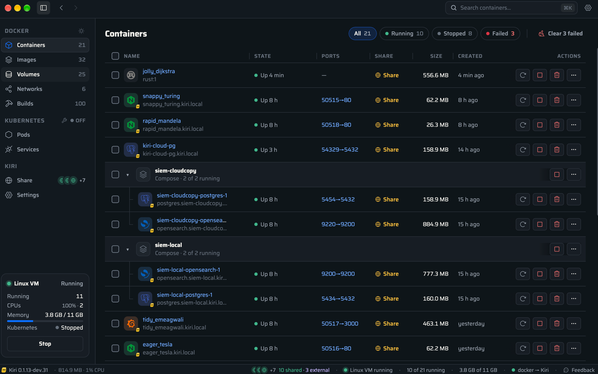

<p align="center">
  <picture>
    <source media="(prefers-color-scheme: dark)" srcset="brand/logo/kiri-horizontal-dark.svg">
    
  </picture>
</p>

<p align="center">
  <b>Um runtime de containers pequeno e rápido para macOS, Windows e Linux.</b><br>
  Roda suas imagens Docker e funciona com o <code>docker</code> CLI, o Compose e o buildx que você já usa.
</p>

<p align="center">
  <a href="README.md">English</a> · <b>Português (Brasil)</b>
</p>

<p align="center">
  <a href="https://runkiri.com/releases/">Download</a> ·
  <a href="docs/features.pt-BR.md">Recursos</a> ·
  <a href="docs/development.pt-BR.md">Compilar a partir do código-fonte</a> ·
  <a href="https://github.com/libracoder/kiri/releases">Versões</a>
</p>

<p align="center">
  <a href="https://github.com/libracoder/kiri/releases/latest"></a>
  <a href="LICENSE"></a>
  <a href="#no-seu-idioma"></a>
</p>

<p align="center">
  🇬🇧 🇮🇩 🇩🇪 🇪🇸 🇫🇷 🇮🇹 🇵🇱 🇧🇷 🇻🇳 🇹🇷 🇷🇺 🇸🇦 🇯🇵 🇰🇷 🇨🇳 🇹🇼<br>
  <sub>O Kiri fala 16 idiomas. <a href="#no-seu-idioma">O seu está entre eles?</a></sub>
</p>

<p align="center">
  
</p>

---

O Kiri é um substituto leve para o Docker Desktop e o OrbStack, escrito em
Rust. Ele roda os containers em uma pequena VM Linux (ou direto no kernel, no
Linux) e fala a Docker Engine API, então suas ferramentas simplesmente funcionam.

O nome vem da palavra igbo *ntakịrị*, "pequeno".

## Por que o Kiri

- **Rápido**: um container inicia e termina em cerca de 2,5 ms pela Docker API. Isso é cerca de 80 vezes mais rápido que o Docker Desktop.
- **Leve**: a VM dorme após 60 s ociosa, o daemon fica em cerca de 15 MB e acorda em cerca de 0,15 s.
- **Compatível**: `docker`, Compose, buildx, `docker login` e imagens amd64 via Rosetta.
- **Domínios locais**: `http://<nome>.kiri.local`, com HTTPS emitido pela autoridade certificadora do próprio Kiri.
- **Mais que containers**: um cluster Kubernetes com um só comando e máquinas Linux.
- **Uma janela nativa** para containers, imagens, volumes e redes, além de um item na barra de menus.
- **No seu idioma**: 16 idiomas, no macOS, no Windows e no Linux.

### No seu idioma

A janela e a configuração do Kiri vêm nestes idiomas. Ele segue o idioma do seu sistema, e você pode trocá-lo em Configurações → Aparência. Em árabe, a janela inteira é lida da direita para a esquerda.

| | Idioma | | Idioma | | Idioma | | Idioma |
|---|---|---|---|---|---|---|---|
| 🇬🇧 | English | 🇫🇷 | Français | 🇻🇳 | Tiếng Việt | 🇯🇵 | 日本語 |
| 🇮🇩 | Bahasa Indonesia | 🇮🇹 | Italiano | 🇹🇷 | Türkçe | 🇰🇷 | 한국어 |
| 🇩🇪 | Deutsch | 🇵🇱 | Polski | 🇷🇺 | Русский | 🇨🇳 | 简体中文 |
| 🇪🇸 | Español | 🇧🇷 | Português (Brasil) | 🇸🇦 | العربية | 🇹🇼 | 繁體中文 |

Falta o seu? As traduções ficam em [`crates/kiri/src/ui/lang`](crates/kiri/src/ui/lang); veja [Contribuindo](#contribuindo).

## Instalação

| Plataforma | Onde obter |
|------------|------------|
| macOS 14+ (Apple silicon ou Intel) | `.dmg` em [runkiri.com/releases](https://runkiri.com/releases/) |
| Windows 10 e 11 (x86-64 ou Arm, via WSL 2) | `.msi` em [runkiri.com/releases](https://runkiri.com/releases/) |
| Linux (Ubuntu, Fedora e outros) | `.deb` ou `.rpm` em [runkiri.com/releases](https://runkiri.com/releases/) |

Na primeira vez que você abre o Kiri, ele cria um contexto Docker `kiri`. O Kiri se atualiza sozinho e verifica antes a assinatura de cada nova versão.

## Início rápido

```sh
docker --context kiri run --rm alpine echo hello
docker --context kiri compose up -d
kiri k8s start                      # Kubernetes de um só nó, como o contexto kubectl `kiri`
kiri machine create dev --distro ubuntu && kiri machine shell dev
kiri import                         # traz imagens, volumes e containers do OrbStack ou do Docker Desktop
```

Os comandos do Docker também funcionam como comandos `kiri` (`kiri run`, `kiri ps`,
`kiri compose up` e assim por diante), e sempre apontam para o Kiri.

## Números

`alpine` executando `true` e sendo removido, mediana de 30 execuções, o mesmo `docker` CLI para os três:

|                | Docker Engine API | `docker` CLI |
|----------------|------------------:|-------------:|
| **Kiri**       | **2,55 ms**       | **14,2 ms**  |
| Docker Desktop | 213 ms            | 243 ms       |
| OrbStack       | 380 ms            | 442 ms       |

O método e todos os outros números estão em [`bench/results.json`](bench/results.json). Rode de novo com `kiri bench`.

## Como funciona

```
docker CLI ─┐
compose ────┼─ Docker Engine API ─► kiri daemon ── vsock ──► guest agent (PID 1)
buildx ─────┤                         owns the VM           clone3 → container
kiri UI ────┘
```

A VM usa um kernel próprio de 10 MB, e o PID 1 dela é um agente Rust de ~900 KB.
Esse agente inicia os containers com um único `clone3` em namespaces e um
cgroup. Não há runc, nem shim, nem dockerd. Mais detalhes em
[docs/development.pt-BR.md](docs/development.pt-BR.md#arquitetura).

## Documentação

- [Recursos](docs/features.pt-BR.md): tudo o que é suportado hoje, arquivos das versões e problemas conhecidos
- [Desenvolvimento](docs/development.pt-BR.md): compilação, execução a partir do código-fonte, arquitetura e organização do repositório
- [Notas de versão](docs/releases) (em inglês)

## Roadmap

O próximo passo é um builder embutido. O Kiri vai servir os próprios endpoints de
build do Docker, então o buildx usa o driver docker contra o Kiri, como faz
contra o Docker Desktop. Isso traz suporte a `host-gateway` para builds com
BuildKit, e as imagens são carregadas direto no Kiri.

## Contribuindo

Issues e pull requests são bem-vindos. Veja o [CONTRIBUTING.md](CONTRIBUTING.md)
e o [Código de Conduta](CODE_OF_CONDUCT.md). Para relatar uma vulnerabilidade
de forma privada, veja o [SECURITY.md](SECURITY.md).

## Licença

[Apache-2.0](LICENSE). As licenças de terceiros estão em [NOTICE](NOTICE). O kernel
do guest é Linux (GPL-2.0); a configuração, os patches e a oferta do código-fonte
estão em [`guest/kernel`](guest/kernel).

O nome "Kiri" e o logotipo do Kiri não são cobertos pela licença. Forks são
bem-vindos, com outro nome e outro logotipo.
