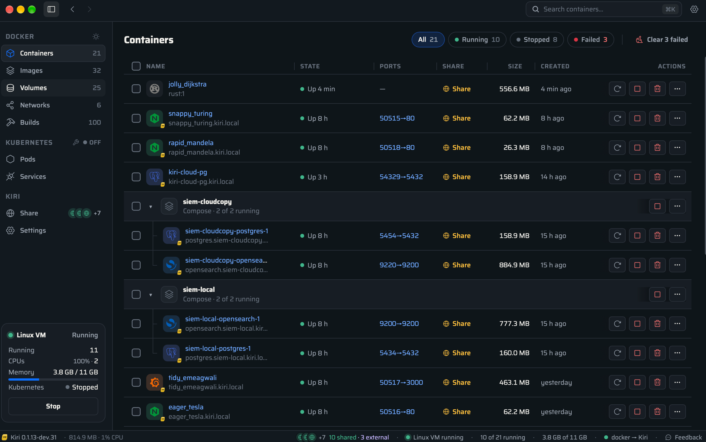

<div align="center">

<p align="center">
  <picture>
    <source media="(prefers-color-scheme: dark)" srcset="brand/logo/kiri-horizontal-dark.svg">
    
  </picture>
</p>

<h1>Kiri：小巧、极速的 macOS / Windows / Linux 容器运行时</h1>

<p>Docker Desktop 启动慢、空闲时占用资源多。Kiri 是用 Rust 编写的轻量级替代品。它能运行你的 Docker 镜像，并且兼容你已经在用的 <code>docker</code> CLI、Compose 和 buildx。</p>

<p align="center">
  <a href="https://github.com/libracoder/kiri/actions/workflows/ui-tests.yml?query=branch%3Amain"></a>
  <a href="https://github.com/libracoder/kiri/releases/latest"></a>
  <a href="LICENSE"></a>
  <a href="https://discord.gg/K5A8wuqcC"></a>
  <a href="crates/kiri/src/ui/lang"></a>
</p>

<p align="center">
  <strong>
    <a href="#快速上手">快速上手</a> ·
    <a href="https://docs.runkiri.com">文档</a> ·
    <a href="docs/features.md">功能特性</a> ·
    <a href="https://runkiri.com/releases/">下载</a> ·
    <a href="SECURITY.md">安全</a> ·
    <a href="README.md">English</a>
  </strong>
</p>

<p align="center">
  
</p>

</div>

---

> 本文档是 [README.md](README.md) 的中文翻译。若两者内容有出入，以英文原版为准。

## 开始之前

请确认你的系统满足以下条件之一：

- macOS 14 或更高版本，Apple 芯片或 Intel 均可
- Windows 10 或 11，启用 WSL 2，x86-64 或 Arm 均可
- Linux（Ubuntu、Fedora 等）

## 第一步：安装并启动 Kiri

macOS 上使用 Homebrew：

```bash
brew install --cask libracoder/kiri/kiri
```

或下载对应系统的安装包：

| 平台 | 获取方式 |
|------|----------|
| macOS 14+（Apple 芯片或 Intel） | 从 [runkiri.com/releases](https://runkiri.com/releases/) 下载 `.dmg`，或执行 `brew install --cask libracoder/kiri/kiri` |
| Windows 10 和 11（x86-64 或 Arm，通过 WSL 2） | 从 [runkiri.com/releases](https://runkiri.com/releases/) 下载 `.msi` |
| Linux（Ubuntu、Fedora 等） | 从 [runkiri.com/releases](https://runkiri.com/releases/) 下载 `.deb` 或 `.rpm` |

首次打开 Kiri 时，它会自动配置一个 `kiri` Docker context。Kiri 会自动更新，并在更新前校验每个新版本的签名。

然后运行你的第一个容器：

```bash
docker --context kiri run --rm alpine echo hello
```

---

## 目录

- [开始之前](#开始之前)
- [安装并启动 Kiri](#第一步安装并启动-kiri)
- [为什么选择 Kiri？](#为什么选择-kiri)
- [快速上手](#快速上手)
- [功能特性](#功能特性)
- [Docker 命令](#docker-命令)
- [基准测试](#基准测试)
- [对比](#对比)
- [Kiri 工作原理](#kiri-工作原理)
- [文档](#文档)
- [路线图](#路线图)
- [社区](#社区)
- [安全](#安全)
- [许可证](#许可证)

---

## 为什么选择 Kiri？

Kiri 在一个小型 Linux 虚拟机中运行容器（在 Linux 上则直接运行于内核之上），并实现了 Docker Engine API，因此你现有的工具可以直接使用。名字来源于伊博语单词 *ntakịrị*，意为"小"。

- **快**：通过 Docker API 启动并退出一个容器约需 2.5 毫秒，比 Docker Desktop 快约 80 倍。
- **轻**：虚拟机空闲 60 秒后自动休眠，守护进程常驻内存约 15 MB，唤醒仅需约 0.15 秒。
- **兼容**：支持 `docker`、Compose、buildx、`docker login`，在 Apple 芯片上可通过 Rosetta 运行 amd64 镜像。
- **本地域名**：`http://<name>.kiri.local`，并由 Kiri 自带的证书颁发机构提供 HTTPS。
- **不止容器**：一条命令启动 Kubernetes 集群，还能创建 Linux 虚拟机。
- **原生窗口**：管理容器、镜像、卷和网络，另有菜单栏图标。
- **你的语言**：窗口支持 38 种语言，macOS、Windows 和 Linux 一致。

---

## 快速上手

```sh
docker --context kiri run --rm alpine echo hello
docker --context kiri compose up -d
kiri k8s start                      # 单节点 Kubernetes，作为 `kiri` kubectl context
kiri machine create dev --distro ubuntu && kiri machine shell dev
kiri import                         # 从 OrbStack 或 Docker Desktop 迁移镜像、卷和容器
```

Docker 的命令同样可以作为 `kiri` 命令使用（`kiri run`、`kiri ps`、`kiri compose up` 等），并且始终指向 Kiri。

---

## 功能特性

| 领域 | 提供的能力 |
|------|------------|
| **容器** | 完整生命周期：`run`、`exec`、`logs`、`attach`、`stop`、`kill`、`restart`、`pause`、`update`、`stats`、`top`、`diff`、`export`、`commit`，以及双向 `cp`。守护进程重启后记录仍然保留。 |
| **资源限制与安全** | `--memory`、`--cpus`、`--pids-limit`、`--shm-size`。Docker 默认 capabilities 和默认 seccomp 过滤器，支持 `--cap-add`/`--cap-drop`、`--privileged`、`--read-only`、`no-new-privileges`。 |
| **网络** | 默认 bridge、按名称和别名 DNS 解析的自定义网络、TCP/UDP 的 `-p`/`-P`、`--network host\|none\|container:<name>`、IPAM（`--subnet`、`--gateway`、`--ip`）、IPv6、`host.docker.internal`。 |
| **本地域名** | 每个容器都有 `http://<name>.kiri.local`，Compose 服务为 `<service>.<project>.kiri.local`，并由 Kiri 自带的证书颁发机构提供 HTTPS。 |
| **存储** | 具名和匿名卷、宿主机路径绑定挂载、`--tmpfs`、`--mount`。 |
| **镜像** | `pull`、`push`、`tag`、`save`、`load`、`history`、`search`，支持 `docker login` 凭据。Apple 芯片上通过 Rosetta 运行 amd64 镜像。 |
| **构建** | 通过 BuildKit 支持 `docker build` 和 `buildx build`，空闲时自动停止。 |
| **Compose** | `up`、`down`、`ps`、`logs`、`exec`、多网络、事件。项目在窗口中分组显示。 |
| **Kubernetes** | `kiri k8s start`：单节点 k3s 集群，约 20 秒就绪，作为 `kiri` kubectl context。LoadBalancer 服务发布在 `localhost` 上。 |
| **Linux 虚拟机** | `kiri machine create dev --distro ubuntu`：你的用户、sudo 和相同路径的家目录，可选 systemd。 |
| **分享** | `kiri share 3000` 将本地端口或容器发布到互联网。 |
| **USB 设备（beta）** | 将串口适配器、Zigbee 棒或开发板交给容器使用。 |
| **内存** | balloon 在运行时归还空闲内存，虚拟机空闲 60 秒后休眠。 |
| **窗口** | 容器、镜像、卷和网络，每个容器都有实时日志、命令行和文件浏览。菜单栏图标显示运行状态。 |
| **导入** | `kiri import` 从 OrbStack 或 Docker Desktop 迁移镜像、卷和容器。 |
| **更新** | Kiri 自动更新，更新前校验每个版本的 SHA-256 和签名。 |

所有参数和已知问题见 **[docs/features.md](docs/features.md)**。

---

## Docker 命令

Kiri 实现了 Docker Engine API，你现有的 `docker` CLI 可以直接对接。只需切换一次 context，其余什么都不用改：

```bash
docker context use kiri
```

| 领域 | 可用命令 |
|------|----------|
| 容器 | `run` `create` `start` `stop` `kill` `restart` `rm` `exec` `logs` `attach` `wait` `rename` `pause` `unpause` `update` `stats` `top` `diff` `export` `commit` `cp` `ps` `inspect` `container prune` |
| 镜像 | `pull` `push` `tag` `images` `rmi` `save` `load` `history` `search` `login` `image prune` |
| 构建 | `build` `buildx build` |
| 网络 | `network create` `ls` `rm` `inspect` `connect` `disconnect` |
| 卷 | `volume create` `ls` `rm` `inspect` `prune` |
| Compose | `compose up` `down` `ps` `logs` `exec` |
| 系统 | `system df` `events` `info` `version` |

同样的命令也可以作为 `kiri` 命令使用，并且始终指向 Kiri：

```bash
kiri run -d --name web -p 8080:80 nginx     # 然后打开 http://web.kiri.local
kiri ps
kiri logs -f web
kiri exec -it web sh
kiri compose up -d
kiri build -t myapp .
```

Kiri 自有命令：

| 命令 | 作用 |
|------|------|
| `kiri start` | 在 Stop 之后重新启动 Kiri，等同于窗口中的 Start |
| `kiri k8s start \| stop \| status \| delete` | 单节点 Kubernetes 集群 |
| `kiri machine create NAME [--distro D] \| list \| shell NAME \| stop \| delete NAME` | Linux 虚拟机 |
| `kiri share PORT\|CONTAINER [--name N]` | 将本地端口或容器分享到互联网 |
| `kiri import [orbstack \| desktop-linux]` | 迁移镜像、卷和容器 |
| `kiri domains [set --http N --https N \| reset]` | 本地域名监听的端口 |
| `kiri usb [list] \| attach DEVICE \| detach DEVICE` | 容器的 USB 设备（beta） |
| `kiri build-with [docker \| kiri]` | 选择 `docker build` 使用的构建器 |
| `kiri update [--check]` | 安装最新版本 |
| `kiri diag logs \| report` | 日志，以及随 bug 报告提交的报告文件 |
| `kiri bench [--runs N] [--network none\|bridge]` | 在你的机器上测量容器启动速度 |
| `kiri ui` | 打开窗口 |

---

## 基准测试

所有数据均为中位数，在同一台机器的一次会话中，使用相同的 `docker` CLI 和相同的镜像对每个引擎测得。

### macOS

`alpine` 运行 `true` 后删除，30 次运行，Apple 芯片 Mac：

| 引擎 | Docker Engine API, p50 | p99 | `docker` CLI, p50 | p99 |
|------|----------------------:|----:|------------------:|----:|
| **Kiri**       | **2.55 ms** | **4.72 ms** | **14.2 ms** | **17.4 ms** |
| Docker Desktop | 213 ms      | 774 ms      | 243 ms      | 351 ms      |
| OrbStack       | 380 ms      | 829 ms      | 442 ms      | 2383 ms     |

Kiri 通过 `docker` CLI 的 14 ms 中，大部分是 CLI 自身的启动时间。

引擎运行时的开销：

| 指标 | Kiri |
|------|-----:|
| 虚拟机冷启动到就绪 | 112 ms |
| 客户机内核启动到 PID 1 | 8 ms |
| 干净关闭虚拟机 | 2.2 ms |
| 从休眠唤醒 | 约 150 ms |
| 虚拟机休眠时守护进程内存 | 约 15 MB |
| 每个容器的 shim 内存 | 0 MB（没有 shim） |
| 空闲时守护进程 CPU | 0.0 % |
| 宿主机到客户机往返，p50 / p99 | 31 µs / 62 µs |
| 客户机内核镜像 | 10 MB |
| 客户机 agent（PID 1 兼容器运行时） | 小于 1 MB |

### Linux

在一台 16 核 x86-64 Ubuntu 24.04 机器上对比六个引擎：

| 引擎 | `run --rm alpine true` | 200 MB 容器 → 宿主机 | 1 GB 绑定挂载写入 | 1 GB 绑定挂载读取 | `build`，3 层，无缓存 | 发布端口 |
|------|----:|----:|----:|----:|----:|----:|
| **Kiri**       | **188 ms** | **209 MB/s** | **1467 MB/s** | **3851 MB/s** | **1113 ms** | 10.3 Gbit/s |
| Docker Engine  | 697 ms  | 56 MB/s  | 819 MB/s | 1307 MB/s | 1723 ms | **100.7 Gbit/s** |
| Podman         | 1105 ms | 70 MB/s  | 593 MB/s | 907 MB/s  | 1148 ms | 51.9 Gbit/s |
| nerdctl        | 631 ms  | 72 MB/s  | 845 MB/s | 1485 MB/s | 1211 ms | 52.4 Gbit/s |
| Colima         | 635 ms  | 20 MB/s  | 493 MB/s | 1496 MB/s | 2472 ms | 0.8 Gbit/s |
| Docker Desktop | 714 ms  | 114 MB/s | 826 MB/s | 1283 MB/s | 2008 ms | 87.8 Gbit/s |

Kiri 启动容器比 Docker Engine 快 3.4 倍，读取绑定挂载快 2.9 倍。在通过发布端口的大流量传输上 Kiri 较慢，因为 Kiri 在用户空间中转发流量：对 Web 应用没有影响，大文件传输时较为明显。完整报告见 [`bench/ubuntu-2026-10-26.md`](bench/ubuntu-2026-10-26.md)。

### Windows

Windows 11，16 核 x86-64 PC，两个引擎均运行于 WSL 2：

| | Kiri | Docker Desktop |
|---|----:|----:|
| `docker run --rm alpine true` | **78 ms** | 491 ms |
| `docker exec … true` | **57 ms** | 89 ms |
| 200 MB 容器 → 宿主机 | **255 MB/s** | 40 MB/s |

完整报告见 [`bench/windows-2026-10-25.md`](bench/windows-2026-10-25.md)。

### 自己跑一遍

```bash
kiri bench --network bridge --runs 30     # 在你的机器上测量容器启动
bench/suite.sh                            # 完整的 Linux 对比测试
```

测试方法和所有其他数据见 [`bench/results.json`](bench/results.json)。

---

## 对比

| | Kiri | Docker Desktop | OrbStack | Colima |
|---|:---:|:---:|:---:|:---:|
| 开源 | ✅ Apache-2.0 | ❌ | ❌ | ✅ MIT |
| 商用免费 | ✅ | 大公司需付费 | 付费 | ✅ |
| macOS | ✅ | ✅ | ✅ | ✅ |
| Windows | ✅ | ✅ | ❌ | ❌ |
| Linux | ✅ | ✅ | ❌ | ✅ |
| 兼容 `docker` CLI、Compose 和 buildx | ✅ | ✅ | ✅ | ✅ |
| 容器、镜像、卷和网络的图形窗口 | ✅ | ✅ | ✅ | ❌ |
| Kubernetes | ✅ | ✅ | ✅ | ✅ |
| Linux 虚拟机 | ✅ | ❌ | ✅ | ❌ |
| 带 HTTPS 的本地域名 | ✅ | ❌ | ✅ | ❌ |
| 虚拟机空闲休眠 | ✅ | ✅ | ❌ | ❌ |
| 从其他引擎导入 | ✅ | ❌ | ✅ | ❌ |
| macOS 容器启动（Docker API, p50） | **2.55 ms** | 213 ms | 380 ms | 未测量 |

---

## Kiri 工作原理

```
docker CLI ─┐
compose ────┼─ Docker Engine API ─► kiri daemon ── vsock ──► guest agent (PID 1)
buildx ─────┤                         管理虚拟机              clone3 → 容器
kiri UI ────┘
```

虚拟机使用定制的 10 MB 内核，其 PID 1 是一个约 900 KB 的 Rust agent。该 agent 通过一次 `clone3` 进入命名空间和 cgroup 来启动容器。没有 runc、没有 shim、也没有 dockerd。更多细节见 [docs/development.md](docs/development.md#architecture)。

---

## 文档

- [docs.runkiri.com](https://docs.runkiri.com)：每个功能的使用指南
- [功能特性](docs/features.md)：当前支持的全部能力、发布文件和已知问题
- [开发指南](docs/development.md)：构建、从源码运行、架构和仓库结构
- [发布说明](docs/releases)

---

## 路线图

接下来是更多分享方式（Tailscale 和 Cloudflare Tunnel，0.3.0）以及 Coolify 支持（0.4.0）。每个版本的计划见 [ROADMAP.md](ROADMAP.md)。

---

## 社区

Kiri 在开放中构建。欢迎提 issue 和 pull request：见 **[CONTRIBUTING.md](CONTRIBUTING.md)** 和[行为准则](CODE_OF_CONDUCT.md)。想迈出贡献第一步？看看 [`good first issue`](https://github.com/libracoder/kiri/issues?q=is%3Aissue+is%3Aopen+label%3A%22good+first+issue%22) 标签下的任务。

<p>
  <a href="https://discord.gg/K5A8wuqcC">
    
  </a>
</p>

<p align="center">
  <a href="https://www.star-history.com/#libracoder/kiri&Date">
    <picture>
      <source media="(prefers-color-scheme: dark)" srcset="https://api.star-history.com/svg?repos=libracoder/kiri&type=Date&theme=dark">
      
    </picture>
  </a>
</p>

感谢这些了不起的贡献者：

<a href="https://github.com/libracoder/kiri/graphs/contributors">
  
</a>

---

## 安全

Kiri 会自动更新，并在更新前校验每个新版本的签名。如需私下报告漏洞，见 **[SECURITY.md](SECURITY.md)**。

---

## 许可证

[Apache-2.0](LICENSE)。第三方许可证见 [NOTICE](NOTICE)。客户机内核为 Linux（GPL-2.0）；其配置、补丁和源码获取方式见 [`guest/kernel`](guest/kernel)。

"Kiri" 名称和 Kiri 徽标不在许可证覆盖范围内。欢迎 fork，但请使用不同的名称和徽标。
