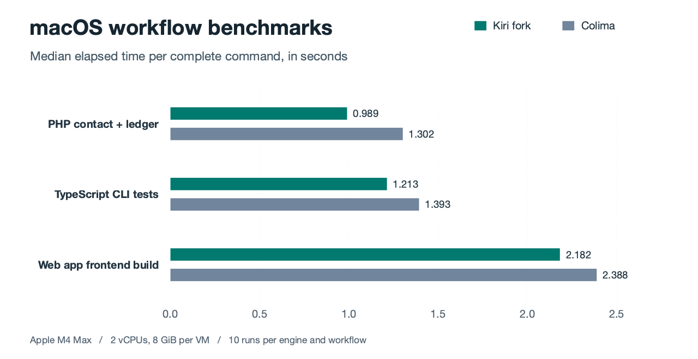

# macOS workflow benchmarks with Linux dependency volumes

On an Apple M4 Max, a Laravel contact-and-ledger check took a median of **989 ms on the Kiri fork and 1,302 ms on Colima**. Both engines kept the source tree in a host bind and the installed dependencies on Linux named volumes. The timings cover the full developer command, including checking the prepared volumes and creating a fresh container.



| Workflow | Kiri fork (ms) | Colima (ms) | Time saved | p95, Kiri / Colima (ms) |
|---|---:|---:|---:|---:|
| PHP contact + ledger | 989 | 1302 | 24.0% | 1643 / 1386 |
| TypeScript CLI tests | 1213 | 1393 | 12.9% | 1373 / 1724 |
| Web app frontend build | 2182 | 2388 | 8.6% | 2712 / 2733 |

The contact command ran two PHPUnit tests with eight assertions on synthetic SQLite data. The CLI command ran 11 existing environment-change tests through pnpm and Vitest. The frontend command ran the application's Bun build through Compose. Each median covers ten timed calls per engine. At this sample size the nearest-rank p95 is the slowest observation. Colima had the lower p95 on the contact check.

## Where the volume helps

These commands run inside existing containers, so they isolate the effect of changing dependency storage. The bind and volume arms use the same Linux-installed dependency contents. The application source stays host-mounted in every arm.

| Command | Kiri bind (ms) | Kiri volume (ms) | Bind / volume on Kiri | Colima bind (ms) | Colima volume (ms) |
|---|---:|---:|---:|---:|---:|
| Load 781 Laravel routes | 429 | 219 | 1.96× | 426 | 249 |
| Contact + ledger | 1443 | 812 | 1.78× | 1342 | 815 |
| CLI tests | 715 | 527 | 1.36× | 735 | 531 |

Placing Composer and workspace package trees on volumes made the largest difference during Laravel bootstrap. With both engines using volumes, the in-container contact checks finished within 4 ms of one another in the median.

## Small host files

| Operation on 4,096 files | Kiri fork median | Colima median |
|---|---:|---:|
| Read 256 bytes from each file | 593 ms | 438 ms |
| Metadata lookup | 20.5 ms | 40.3 ms |

These are the control arms of the direct-roots experiment, with 20 observations per engine. Reading 1 MiB across 4,096 host files took **35% longer on Kiri**. Metadata lookup took **49% less time**. The two share-layout trials produced inconsistent small-read gains. Two further experiments measured fixed VM memory and additional cache headroom on mixed application commands. Their samples are also included in the data.

## Setup and data

- One macOS ARM64 host with an Apple M4 Max and 128 GB RAM. Each VM had two vCPUs and an 8 GiB memory ceiling. Kiri used its default ballooning policy.
- The tested Kiri build was `496e7ed4a1c64cdb3162a7f747d7aedcf7f517bf`, a local integration of the changes in [#192](https://github.com/libracoder/kiri/pull/192) and [#193](https://github.com/libracoder/kiri/pull/193) on `4645536`. Kernel versions were `6.18.58` for Kiri and `6.8.0-117-generic` for Colima. Colima's Docker server reported `29.5.2`. The measurements apply to this fork build and host.
- Both engines used the same application snapshots and Linux toolchains. Package installation completed before timing. The host caches were warm, and concurrent host load could affect the results.
- Hyperfine 2.0.0 ran two blocks in opposite engine order, with a warmup for each arm per block. Time saved is `1 − Kiri median / Colima median`. The chart covers 60 timed calls. The full campaign covers 560 across 26 blocks, including the storage-layout and rejected tuning experiments.
- The contact table uses `webapp-contact-write-v2`, which writes PHPUnit's result cache to a writable temporary directory. The earlier `webapp-contact-write` samples carry a cache-write warning and are retained for provenance.

The [individual wall-clock samples](macos-workflows-2026-11-12.json) preserve run order within each block. The exact application snapshots are local to this measurement. Reviewers can recalculate the published statistics directly from the shared timings. For example, this command prints the median and nearest-rank p95 for the contact workflow in milliseconds.

```sh
jq '[.blocks[] | select(.experiment == "native-webapp-contact") | .arms[]]
    | group_by(.arm)[] | .[0].arm as $arm | map(.ms[]) | sort
    | length as $n | {arm: $arm, n: $n,
      median_ms: ((.[($n/2|floor)] + .[(($n-1)/2|floor)]) / 2),
      p95_ms: .[($n * 0.95 | ceil) - 1]}' bench/macos-workflows-2026-11-12.json
```
